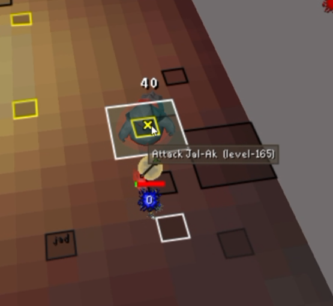

# Yellow Click Fix
A RuneLite plugin to aid in the Jagex's "yellow click" issue which is inherent
to their client. This issue often happens when one is moving their cursor
quickly between two locations which have different menu options. For example,
from the ground to an NPC they want to attack. If the click arrives less than
one client cycle after the cursor reached the NPC, the menu entries are not
rebuilt and are stale. This generally results in a yellow click "Walk here"
through an NPC instead of the intended "Attack".

